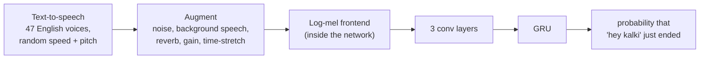
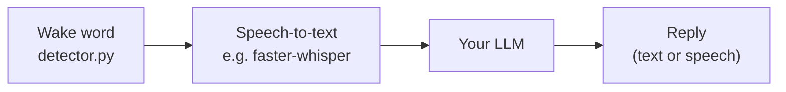

# Hey Kalki: a tiny wake word model

[](https://github.com/yeshwanthguru/kalki-wakeword/actions/workflows/test.yml)

A **232 KB** "hey kalki" wake word detector that runs on a plain CPU, in a browser tab, or inside your own
Python app. It was trained **entirely on synthetic speech**, so you do not need to record anyone to start,
and you can retrain it for your own phrase.

**[Try it in your browser](https://yeshwanthguru.github.io/kalki-wakeword/)**: press a play button to push a sample
through the model, or use your microphone. Nothing leaves your device.

[](https://yeshwanthguru.github.io/kalki-wakeword/)

> **Status: early, and I want your feedback.** It works well on synthetic voices it has never seen, but it has
> had little testing on real people and real microphones. If you try it, please tell me how it did:
> **[share your results in 1 minute](https://github.com/yeshwanthguru/kalki-wakeword/issues/new?template=feedback.yml)** (see [Feedback](#feedback-wanted)).

## Quick start

```bash
pip install numpy onnxruntime sounddevice
python live.py              # say "hey kalki"
```

Use it in your own code:

```python
from detector import WakeWordDetector

det = WakeWordDetector(threshold=0.8)      # loads models/kalki_int8.onnx
for hit in det.push(samples):              # float32 mono 16 kHz audio, any chunk size
    print(f"heard it (p={hit.prob:.2f})")
```

`detector.py` is one small file with no training dependencies. The model is also usable from any language
with an ONNX runtime (input: 24,000 float samples = 1.5 s of 16 kHz audio, output: one logit).

## How well does it work?

Measured on a fixed synthetic test set: 2,000 windows with the wake word and 2,000 without, from 5 voices that
were never used in training, with room reverb added. These are **synthetic voices, not real people**.

| Metric | Value |
|--------|------:|
| AUC | 0.993 |
| Wake words caught at threshold 0.5 | 92.6% |
| False triggers per 1.5 s window at 0.5 | 1.9% |
| Wake words missed at 1% false-accept rate | 10.5% |
| Model size (int8 / fp16 / fp32) | 232 KB / 444 KB / 881 KB |
| CPU time per window (1 thread) | about 0.6 ms |

The three sizes score the same. int8 stores the weights as 8-bit numbers and expands them when loaded, so it
is smaller on disk, not faster.

### Choosing a threshold

A 15-minute simulated stream with 49 wake words mixed into dense speech and noise. The stream is small, so
treat the per-hour numbers as rough.

| Threshold | Wake words caught | False alarms per hour |
|----------:|------------------:|----------------------:|
| 0.5 | 98% | 56 |
| 0.7 | 98% | 28 |
| 0.8 (default) | 96% | 28 |
| 0.9 | 92% | 20 |
| 0.95 | 92% | 8 |

### Why this network

I compared four designs on the same data (`benchmark.py`). The small CNN+GRU won: the GRU is what captures word
order, and making the network 4x wider added nothing.


| Model | Params | AUC | Recall @0.5 | False-pos @0.5 | Stream false alarms/hour |
|-------|-------:|----:|------------:|---------------:|-------------------------:|
| MLP baseline (ignores word order) | 11K | 0.835 | 75.3% | 25.6% | 144 |
| CNN, no GRU | 33K | 0.986 | 88.4% | 3.9% | 12 |
| **CNN+GRU (this repo)** | **55K** | **0.996** | **93.2%** | **1.1%** | **4** |
| CNN+GRU, 4x wider | 199K | 0.996 | 93.3% | 1.4% | 20 |

That table is the first round, on an easier test set (no reverb) with the first training set. The headline
numbers above are from the second round: 2.5x more data plus reverb. Same network, AUC 0.988 to 0.993 on
the harder test (`compare_versions.py`, `docs/v1_vs_v2.json`).

## How it works



- **Input:** 1.5 s of raw 16 kHz audio, scored every 80 ms. The mel frontend is built from fixed convolutions, so the
  ONNX file takes raw audio and needs no preprocessing code.
- **Training data:** about 2,300 positive and 2,300 negative clips. Negatives include near-misses ("hey kali",
  "hey Google", "kalki" alone), ordinary sentences, cut-off wake words, and background noise.
- **Trigger rule:** probability above the threshold for 2 windows in a row, then a 1.5 s cooldown.

## Where you could use it

Ideas, not shipped products. The model is small and fast enough for all of them, but I have only validated it
on synthetic speech:

- Hands-free activation for a hobby voice assistant or home-lab project
- A wake step for a kiosk, demo or voice-controlled web page (it already runs in a browser)
- A low-power gate that keeps heavier speech recognition off until someone says the word
- A starting point for a **custom wake word**: change the phrases in `gen_tts.py` and retrain (see below)

Not suited to anything safety-critical, and the false alarm rates above are for a lab stream, not your living room.

### Use it with an LLM

The detector decides *when* to listen. Chain it with speech-to-text and a language model:



[`examples/with_llm.py`](examples/with_llm.py) is a starting sketch: wake word, then record until you stop talking,
transcribe, call `ask_llm()`, which you replace with your own model. The wake word part is tested; the speech
and LLM glue is an untested sketch. I built this to front a small language model I am training from scratch.

## Train your own

```bash
pip install -r requirements.txt

python gen_tts.py --per-voice 50     # synthesizes clips with Edge TTS (internet, no API key)
python train.py --steps 8000         # about 45 min on a laptop GPU; writes out/kalki.onnx
python quantize.py                   # fp16 and int8 copies in models/
python tune_threshold.py             # missed wake words vs false alarms per threshold
```

**A different wake word:** edit `POSITIVE` and `HARD_NEGATIVE` in `gen_tts.py` (near-misses matter most),
regenerate, retrain. File names keep the `kalki` prefix.

**Teach it your own voice** (recommended, since training only hears synthetic speech):

```bash
python record_real.py positive -n 40         # say the phrase 40 times
python record_real.py negative --minutes 5   # normal talking, TV, fan, typing
python score_real.py split                   # set some clips aside BEFORE training (moved to real_test/)
python score_real.py score --model models/kalki_int8.onnx    # baseline on your held-out clips
python train.py --steps 8000                 # your remaining clips are shown 20x more often
python score_real.py score --model models/kalki_int8.onnx --model out/kalki.onnx   # before vs after
```

`score_real.py` plays your held-out clips through the model exactly as `live.py` would hear them and reports how many
wake words it caught (with a 95% interval, because 10 clips is a small sample) and the false alarms per hour on your
negative recordings. It also lists which files were missed or fired falsely. Compare models on the same clips rather
than treating one number as a final grade.

## Known limits

- Trained and tested on synthetic speech. Accuracy on real voices, accents and microphones is unknown.
- English text-to-speech voices only.
- The false-alarm numbers come from a 15-minute simulated stream with 49 wake words.
- The exported model runs one window at a time (batch size 1), which is how the detector uses it.
- Training data comes from Microsoft Edge text-to-speech through the unofficial `edge-tts` package. The 7
  demo clips in `docs/clips` were made that way. Check the service terms before any commercial use.

## Feedback wanted

This is where I would most like help. **[Open the feedback form](https://github.com/yeshwanthguru/kalki-wakeword/issues/new?template=feedback.yml)**; it asks for:

- **How many of 10 "hey kalki" attempts it caught**, and how many false triggers in a few minutes of normal talking
- Your **microphone or device**, accent, and room (quiet, TV, fan, café)
- The **threshold** you ended up using
- Any word it confuses with "hey kalki"

Recordings are even better, but only share ones you are comfortable sharing. I will use the feedback to add
real data and retrain.

## Tests

```bash
pip install numpy scipy onnxruntime soundfile pytest
pytest
```

The tests also cover `score_real.py` (split, resampling, confidence interval). They check that all three model files fire on the three "hey kalki" sample clips and stay quiet on the other four,
that the result does not depend on audio chunk size, and that silence never triggers. They run on every push.

## License

MIT, see [LICENSE](LICENSE).
