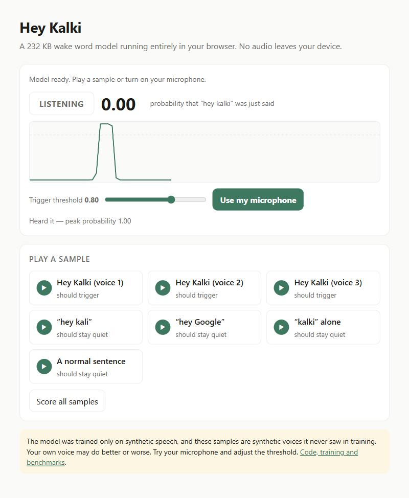
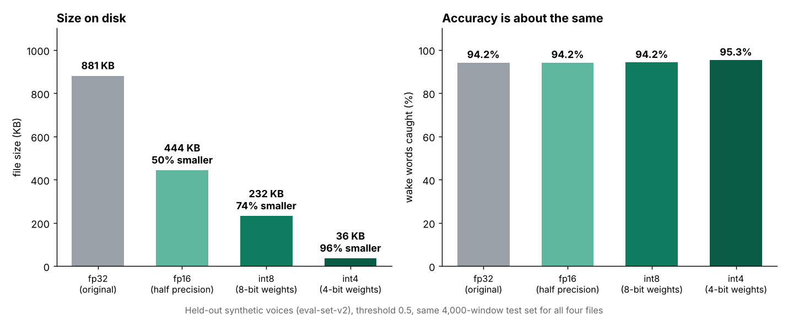
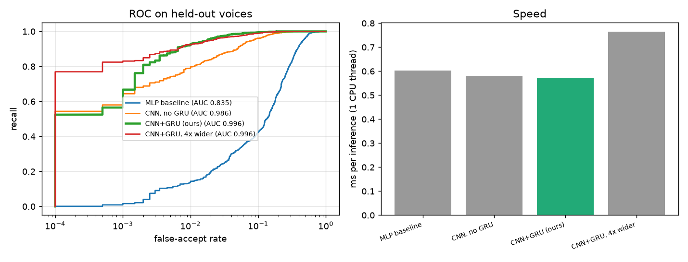
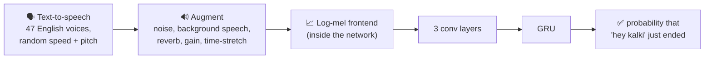

<div align="center">

# 🎙️ Hey Kalki

### A tiny wake word model: **232 KB**, runs on a plain CPU or in a browser tab, trained with **zero recordings**.

[](https://github.com/yeshwanthguru/kalki-wakeword/actions/workflows/test.yml)

[](https://github.com/yeshwanthguru/kalki-wakeword/releases)


[](LICENSE)

**[▶ Live demo](https://yeshwanthguru.github.io/kalki-wakeword/)** &nbsp;·&nbsp;
**[💬 Share feedback](https://github.com/yeshwanthguru/kalki-wakeword/issues/new?template=feedback.yml)** &nbsp;·&nbsp;
**[📦 Model files](#-the-model-files-and-how-theyre-compressed)** &nbsp;·&nbsp;
**[📊 Benchmarks](#-benchmarks-how-good-is-it)** &nbsp;·&nbsp;
**[🧰 Use cases](#-where-you-can-use-it)**

[](https://yeshwanthguru.github.io/kalki-wakeword/)

</div>

Say **"hey kalki"** and it fires. Everything runs on-device: no cloud, no account, no audio leaves your machine.
It learned the phrase from **synthetic speech** (text-to-speech voices plus noise and reverb), so you don't need to record
anyone to start, and you can retrain it for a phrase of your own.

> **Status: early, and I want your feedback.** On synthetic voices it has never heard it works well. On real people and
> real microphones it has had little testing. If you try it, please
> **[tell me how it went (1 minute)](https://github.com/yeshwanthguru/kalki-wakeword/issues/new?template=feedback.yml)**.

## At a glance

| | |
|---|---|
| **Wake phrase** | "hey kalki" |
| **Model size** | 232 KB (int8), 444 KB (fp16), 881 KB (fp32), all the same accuracy |
| **Network** | 55,105 parameters: 3 conv layers + a GRU |
| **Input** | 1.5 s of raw 16 kHz mono audio (no preprocessing needed) |
| **Output** | probability that the wake word *just ended*, every 80 ms |
| **Speed** | about 1.5 to 2 ms per window on one laptop CPU thread, roughly 2% of a core |
| **Held-out accuracy** | AUC 0.993; catches 92.6% of wake words at 1.9% false triggers per window (synthetic voices) |
| **Runs in** | Python (ONNX Runtime), any language with an ONNX runtime, and the browser (WebAssembly) |
| **License** | MIT |

## Contents

[Try it](#-try-it-in-30-seconds) · [Model files & compression](#-the-model-files-and-how-theyre-compressed) ·
[Benchmarks](#-benchmarks-how-good-is-it) · [How it works](#-how-it-works) · [Use cases](#-where-you-can-use-it) ·
[Train your own](#-train-your-own) · [Project layout](#-project-layout) · [Known limits](#-known-limits) ·
[Feedback](#-feedback-wanted)

## 🚀 Try it in 30 seconds

**In your browser:** open the **[live demo](https://yeshwanthguru.github.io/kalki-wakeword/)**. Press a play button to push a
sample clip through the model, or use your microphone.

**On your computer:**

```bash
pip install numpy onnxruntime sounddevice
python live.py              # then say "hey kalki"
```

**In your own code** (a pip package, CPU only, 215 KB with the model inside):

```bash
pip install git+https://github.com/yeshwanthguru/kalki-wakeword      # or: pip install kalki_wakeword-<version>-py3-none-any.whl (from a release)
python -m kalki_wakeword clip.wav                                     # check the install on a 16 kHz 16-bit wav
```

```python
from kalki_wakeword import WakeWordDetector

det = WakeWordDetector(threshold=0.8)       # loads the bundled kalki_int8.onnx
for hit in det.push(samples):               # float32 mono 16 kHz audio, any chunk size
    print(f"heard it (p={hit.prob:.2f})")
```

The package depends only on `numpy` and `onnxruntime`. It is not on PyPI yet (publishing needs a PyPI account and token); the
git URL and the wheel attached to each release work today. Inside a checkout, `from detector import WakeWordDetector` still
works. The package carries its own copy of the int8 model (`kalki_wakeword/models/`), which a test keeps identical to `models/`.
Any language with an ONNX runtime can use the model directly: input is 24,000 float samples (1.5 s at 16 kHz), output is one logit.

**In JavaScript** (browser or Node.js; `js/`, 205 KB with the model, you bring `onnxruntime-web` or `onnxruntime-node`):

```js
import * as ort from "onnxruntime-web";
import { WakeWordDetector } from "kalki-wakeword";

const det = await WakeWordDetector.create(ort, { threshold: 0.8 });
for (const hit of await det.push(float32Samples)) console.log(`heard it at ${hit.time.toFixed(2)}s`);
```

Install it from the `.tgz` attached to each release (`npm install ./kalki-wakeword-<version>.tgz`) or run `npm pack` in `js/`. It is not on
the npm registry yet (that needs an npm account and token). The tests check that Node and a real browser (headless Chromium with
`onnxruntime-web`) give the same detection times and probabilities as the Python package on the demo clips.

## 📦 The model files and how they're compressed

There is **one model** (one trained network) shipped in **three file formats**. They differ only in how precisely each
number is stored. Accuracy is the same; size is not.



| File | Precision | Size | Wake words caught | AUC | CPU / window |
|------|-----------|-----:|------------------:|----:|-------------:|
| [`kalki_int8.onnx`](models/kalki_int8.onnx) | 8-bit | **232 KB** (-74%) | 92.7% | 0.9930 | ~1.7 ms |
| [`kalki_fp16.onnx`](models/kalki_fp16.onnx) | 16-bit | 444 KB (-50%) | 92.6% | 0.9930 | ~1.5 ms |
| [`kalki_fp32.onnx`](models/kalki_fp32.onnx) | 32-bit | 881 KB (original) | 92.6% | 0.9930 | ~1.7 ms |

**Which one?**

- **`kalki_int8.onnx`** (default): when download size matters, such as web pages and apps. The browser demo loads this one.
- **`kalki_fp16.onnx`**: smaller than the original, but with no rounding of the weights to integers.
- **`kalki_fp32.onnx`**: the exact trained numbers; use it if you plan to retrain or convert it to another format.

Accuracy is measured on the same 4,000-window held-out test set for all three. Speeds are one thread on a laptop CPU and
vary with machine load, so treat them as "about the same", not as a ranking.

### What is quantization?

A neural network is a big list of numbers (weights). Normally each is stored in 32 bits. **Quantization** stores them
with fewer bits, which makes the file smaller. If the model is robust to a little rounding, accuracy barely changes. This
one is.

```
fp32  ████████████████  32 bits per number   881 KB
fp16  ████████          16 bits per number   444 KB
int8  ████               8 bits per number   232 KB
```

**How each file was made** (`quantize.py` rebuilds all three from the trained network):

1. **fp32:** the network exported to ONNX as trained.
2. **fp16:** every weight converted to a 16-bit float with `onnxconverter-common`. Inputs and outputs stay fp32, so you
   use it exactly the same way.
3. **int8:** each layer's weights are rounded to 8-bit integers, with one scale factor per output channel (so a large
   weight in one channel doesn't wash out the others). The file stores the int8 numbers plus the scales, and a small
   `DequantizeLinear` step turns them back into floats when the model loads. I wrote this step myself because ONNX
   Runtime's built-in dynamic quantizer fails on this model's GRU layer.

**What to know about int8 here:** it is *weight-only* compression. The file is 74% smaller, but the math at run time still
happens in floats, so it is **not faster**. A true integer-math build (for microcontrollers, say) is not done yet. Across the 4,000-window test
set, fp16 moved any single window's probability by at most 0.003, and int8 by at most 0.17 in the worst window, while
overall accuracy was unchanged. The int8 file is the one the browser demo loads.

## 📊 Benchmarks: how good is it?

**The short answer:** it is the best of the four designs I tried, it holds its accuracy when compressed, and it is small and
fast. What I *can't* tell you yet is how it does on real voices, because it was trained and tested on synthetic speech.

| ✅ What the numbers support | ⚠️ What they don't |
|---|---|
| Best of four network designs I compared | Accuracy on real voices, accents and microphones is unknown |
| 232 KB with no measurable accuracy loss | False alarms are higher than a polished commercial detector (see below) |
| Roughly 2% of one CPU core | No head-to-head against other wake word systems yet (different phrases, no shared test set) |
| Retraining with more data and reverb improved it | The stream test has only 49 wake words, so per-hour figures are rough |

### 1. Detection quality (held-out synthetic voices)

5 voices never used in training, 2,000 windows with the wake word and 2,000 without, with room reverb added.

| Metric | Value | What it means |
|--------|------:|---------------|
| AUC | **0.993** | how cleanly it separates wake words from everything else (1.0 = perfect) |
| Wake words caught at threshold 0.5 | **92.6%** | |
| False triggers per 1.5 s window at 0.5 | **1.9%** | on windows that include near-miss phrases like "hey kali" |
| Wake words missed when false alarms are held to 1% | 10.5% | |
| Equal error rate | 4.4% | the point where misses and false alarms are equal |

### 2. Real-time streaming test

A 15-minute simulated stream with 49 wake words mixed into dense speech and noise, scored every 80 ms the way a live
microphone would be. This is where the **threshold** you choose matters:

| Threshold | Wake words caught | False alarms per hour |
|----------:|------------------:|----------------------:|
| 0.5 | 98% | 56 |
| 0.7 | 98% | 28 |
| **0.8 (default)** | **96%** | **28** |
| 0.9 | 92% | 20 |
| 0.95 | 92% | 8 |

Lower the threshold if it misses you; raise it if it fires on background noise. The stream is far busier with speech than a
typical living room, but it is small (about a dozen false-alarm events per setting), so treat these as rough. Detectors built for
products usually aim for **far fewer** false alarms than this, so this model is not at that level yet.

### 3. Four network designs, same data

I trained four designs on identical data and scored them on one fixed test set (`benchmark.py`).



| Model | Params | AUC | Recall @0.5 | False-pos @0.5 | Stream false alarms/hour | CPU ms/window |
|-------|-------:|----:|------------:|---------------:|-------------------------:|--------------:|
| MLP baseline (ignores word order) | 11K | 0.835 | 75.3% | 25.6% | 144 | 0.60 |
| CNN, no GRU | 33K | 0.986 | 88.4% | 3.9% | 12 | 0.58 |
| **CNN + GRU (this repo)** | **55K** | **0.996** | **93.2%** | **1.1%** | **4** | **0.57** |
| CNN + GRU, 4× wider | 199K | 0.996 | 93.3% | 1.4% | 20 | 0.76 |

**Reading it:** the GRU is what matters, because it keeps track of word order (0.986 → 0.996 AUC). Making the network 4×
bigger adds nothing measurable and gives more false alarms, so the small one wins on the trade-off. (This round used the
first, smaller training set and an easier test without reverb, which is why its numbers differ from sections 1 and 2. The CPU
times were also measured earlier on a quieter machine than the 1.5 to 2 ms in the model-files table, so compare rows within a
table, not across tables.)

### 4. More data and reverb improved it

The shipped model is the second round: 2.5× more training clips and room reverb in the augmentation, same network. Both
versions on the same harder test (`compare_versions.py`):

| Metric | First version | **Shipped (retrained)** |
|--------|--------------:|------------------------:|
| AUC | 0.9879 | **0.9930** |
| Wake words caught @0.5 | 88.7% | **92.6%** |
| Missed at 1% false-accept | 15.5% | **10.5%** |
| Equal error rate | 5.9% | **4.4%** |
| Stream: wake words caught @0.8 | 94% | **96%** |
| Stream: false alarms per hour @0.8 | **20** | 28 *(5 vs 7 events in 15 min, within noise)* |

### 5. Browser check

The live demo scores its 7 built-in sample clips (3 "hey kalki", 4 others) through the int8 model in WebAssembly: all 7
are classified correctly, and the same clips are checked on every commit by the automated tests.

Raw numbers are in [`docs/`](docs): `v1_vs_v2.json`, `threshold_sweep.json`, `benchmark.json`.

## 🔧 How it works



- **Trained without recordings.** About 2,300 positive and 2,300 negative clips from text-to-speech. Negatives include
  near-misses ("hey kali", "hey Google", "kalki" alone), ordinary sentences, cut-off wake words and pure noise.
- **Raw audio in.** The mel-spectrogram frontend is built from fixed convolutions inside the ONNX file, so there is no
  preprocessing code to port.
- **Trigger rule.** Probability above the threshold for 2 windows in a row, then a 1.5 s cooldown, so one utterance fires once.

## 🧰 Where you can use it

These are ideas the model is small and fast enough for. It has only been validated on synthetic speech, so try it with your own
voices before relying on it.

| Use case | Why it fits | Watch out for |
|----------|-------------|---------------|
| **Hands-free hobby assistant** (Raspberry Pi, home lab) | on-device, ~2% of a CPU core, no cloud | tune the threshold for your room |
| **Voice assistant front door** | decides *when* to start heavier speech-to-text and a language model; see [`examples/with_llm.py`](examples/with_llm.py) (untested sketch) | the speech-to-text step is separate |
| **Voice-controlled web page or kiosk** | runs in the browser, nothing to install, audio stays local | needs microphone permission over HTTPS |
| **Privacy-first apps** | no audio leaves the device | the model hears everything until the word is spoken |
| **Low-power gate** | keeps expensive speech recognition off until triggered | scores every 80 ms; a true int8 or streaming build would cut power further |
| **Games and interactive installations** | tiny download, instant start | background noise and music can cause false triggers |
| **Accessibility and hands-busy settings** | wake by voice while hands are occupied | not tested with diverse or impaired speech |
| **A starting point for your own wake word** | the whole pipeline, [trainable in about 45 minutes](#-train-your-own) | needs near-miss phrases for good false-alarm behavior |

**Not suited to** safety-critical use, or anywhere a false trigger has serious consequences.

## 🧪 Train your own

```bash
pip install -r requirements.txt

python gen_tts.py --per-voice 50     # synthesize clips with Edge TTS (needs internet, no API key)
python train.py --steps 8000         # about 45 min on a laptop; writes out/kalki.onnx
python quantize.py                   # rebuild the fp16 and int8 files in models/
python tune_threshold.py             # misses vs false alarms at each threshold
```

**A different wake word:** edit `POSITIVE` and `HARD_NEGATIVE` in `gen_tts.py` (near-misses matter most), regenerate and
retrain. Output files keep the `kalki` prefix.

**Teach it your own voice** (recommended, because training only hears synthetic speech):

```bash
python record_real.py positive -n 40         # say the phrase 40 times
python record_real.py negative --minutes 5   # normal talking, TV, fan, typing
python score_real.py split                   # set some clips aside BEFORE training (moved to real_test/)
python score_real.py score --model models/kalki_int8.onnx    # baseline on your held-out clips
python train.py --steps 8000                 # your remaining clips are shown 20x more often
python score_real.py score --model models/kalki_int8.onnx --model out/kalki.onnx   # before vs after
```

`score_real.py` plays your held-out clips through the model exactly as `live.py` would hear them and reports how many wake
words it caught (with a 95% interval, because 10 clips is a small sample) and the false alarms per hour on your negative
recordings. It also lists which files were missed or fired falsely.

**Fewer false alarms: mine hard negatives.** The model only hears synthetic speech, so real audio can trigger it in ways the
training set never covered. `mine_negatives.py` scans audio that does *not* contain the wake word (podcasts, TV, LibriSpeech,
room noise), saves every false trigger to `data/negative/mined_<round>_<n>.wav` and reports false alarms per hour of real audio.
`train.py` treats those clips as hard negatives, so retrain and mine again:

```bash
python mine_negatives.py --audio path/to/speech_without_the_wake_word --tag r1
python train.py --steps 6000 && python quantize.py
python mine_negatives.py --audio path/to/speech_without_the_wake_word --tag r2   # should find fewer
```

**Noise augmentation.** Training backgrounds now include impulsive sounds (clicks, knocks), babble made of other speech, and
cheap-microphone coloring (band-limits, bit crush), on top of the colored noise. Drop real noise recordings into `data/noise/`
(any wavs) and they are mixed in too. `python train.py --no-augment` restores the old backgrounds for comparison.

In the cloud, the `retrain` workflow does both (`mine_rounds`, `corpus_url`, `noise_url` inputs).

**Releasing a version.** Push a tag from a commit on `main` (`git tag v0.3.0 && git push origin v0.3.0`). The `release`
workflow re-scores the models, fails if they regress against `docs/baseline.json`, and publishes a GitHub Release with the
three ONNX files, `SHA256SUMS.txt` and the score table.

**Real recordings from feedback issues.** The feedback form lets people attach `.wav`/`.flac`/`.ogg` files or a zip and say
what is in them. A maintainer adds the `score-audio` label and the `score-feedback` workflow replies with wake words caught,
false alarms per hour and which files were missed (`python feedback_audio.py score --body issue.md` does the same locally).
The audio is decoded in memory and deleted; only the numbers are posted. Recordings whose owners ticked the consent box can be
collected into a zip (`positive/` and `negative/` folders) and fed to the `retrain` workflow's `real_clips_url` input, or
installed locally with `python feedback_audio.py install --zip clips.zip`. Real clips train 20x (wake words) and 5x
(negatives) more often than synthetic ones.

**A second voice source and training options (for A/B runs).** `gen_piper.py` adds multi-speaker Piper voices (offline, open
models) to the training set; their clips are named `pp...` and are never held out, so benchmark numbers stay comparable with
edge-tts-only runs. `train.py` has opt-in `--specaugment` (mask mel bands and frames), `--ema 0.999` (train a moving average
of the weights and save that) and `--label-smoothing 0.05`; none change the saved model's format. The `retrain` workflow takes
`piper_voices`, `piper_speakers` and `train_args` inputs and ends with a "Retrain vs baseline" table in the run summary, so
two runs that differ in one option can be compared directly. Check each Piper voice's licence before commercial use.

**A frozen evaluation set.** Regenerating TTS clips changes the audio a little each time, which moved the PR gate by about
8 false alarms per hour with identical models. Run the `eval-set` workflow once: it publishes the held-out voices' clips as the
release `eval-set-v1`. From then on the PR gate, `release` and `retrain` download that set (`python eval_set.py fetch`) and score
on exactly the same audio, and those voices are kept out of training. A baseline measured on a different set is not compared;
the gate re-records it on the new set. Until a set is published everything works as before.
`eval-set-v1` had only 120 clips from 5 held-out voices (one clip is about 1.7 points, and a 15-minute stream counts false alarms in
steps of 4 per hour), which was too coarse to tell training variants apart. The default is now `eval-set-v2`: 870 clips (438 wake word,
432 other) from 11 held-out voices and a 60-minute stream (one false alarm = 1 per hour). A quarter of the voices are held out, so
training sees fewer voices. Still treat differences of a point or two as noise until run-to-run variance has been measured.

**CPU-only training.** Training and evaluation always run on the CPU, on purpose: the network has 55k parameters and most of a
training step is building the augmented audio batch, which is CPU work anyway. `train.py` builds batches in worker processes
while the network trains (`--workers N`, default automatic, `0` = in the training loop). Measured on a 4-core CPU: 32 min for
6000 steps down to about 13 min (2 workers + 2 training threads). The `retrain` workflow uses the CPU build of torch.

**Reproducible runs and comparing them.** `train.py --seed N` seeds the network init and the batch streams: two runs with the same
seed and data give identical weights (checked, also with worker processes), different seeds differ; without `--seed` runs differ
as before (pass `train_args=--seed 1` to `retrain`). Every `retrain` run now uploads a `retrain-report` artifact with
`ci_report.json` (the scores) and `run_info.json` (the exact inputs), so runs can be compared without reading logs:

```bash
python summarize_runs.py control=run4/ci_report.json control=run5/ci_report.json control=run6/ci_report.json \
                         specaug=run7/ci_report.json --reference control
```

It prints mean and min-max per group and marks a metric `*` only when a group's mean is clearly outside the reference group's
range. Repeat a setting a few times first: with three identical runs the range is only a rough estimate of the noise.

**Trigger settings.** `python tune_trigger.py` (after `python eval_set.py fetch`) replays the detector's trigger rule (probability
threshold x consecutive hits) on the frozen stream for a model and prints wake words caught and false alarms per hour for each
setting, marks the default (0.8 x 2) and recommends the fewest false alarms within 1% of the best recall. On `eval-set-v2` the
committed model gives 97% / 27 false alarms per hour at the default, 97% / 22 at 3 hits, and 95% / 13 at 3 hits and 0.9 (each extra
hit adds 80 ms). That is one synthetic stream, so confirm with `score_real.py` on real recordings before changing a default.

**Replacing the shipped model.** Run the `promote` workflow with the id of a successful `retrain` run on `main`: it opens a pull
request that copies that run's models into `models/` and `docs/kalki_int8.onnx`, records the new `docs/baseline.json` on the frozen
set and adds the score and trigger tables. Nothing is merged for you.

**How much synthetic data.** On `eval-set-v2` (11 held-out voices, 60-minute stream), 40 clips per voice per class beat 12 on three
seeds (AUC 0.9944 vs 0.9931 on average, false alarms 29 to 40 vs 47 to 56 per hour); 100 per voice was not clearly better than 40.
`gen_tts.py` and the `retrain` workflow now default to 40. Extra mining rounds, SpecAugment with weight averaging and Piper voices did
not help (they moved the operating point or made real-speech false alarms worse).

## 📁 Project layout

```
models/            kalki_int8.onnx · kalki_fp16.onnx · kalki_fp32.onnx
kalki_wakeword/    pip package: streaming detector + bundled model (detector.py is a shim)
js/                npm package for the browser and Node.js (same detector and model)
live.py            microphone demo for the terminal
docs/              browser demo (index.html), sample clips, charts, raw benchmark numbers
gen_tts.py         synthesize training clips      train.py          train the network
mine_negatives.py  find false triggers in real audio  augment.py    background-noise augmentation
feedback_audio.py  score / install recordings from feedback issues
gen_piper.py       second TTS source (Piper multi-speaker voices)
eval_set.py        build / fetch the frozen evaluation set
summarize_runs.py  mean/range of several retrain runs vs a reference group
tune_trigger.py    threshold x hits sweep on the frozen stream
model.py           the network                    quantize.py       make the fp16 and int8 files
benchmark.py       compare network designs        compare_versions.py   compare two trained versions
tune_threshold.py  threshold trade-off            record_real.py / score_real.py   your own voice
tests/             regression tests (run on every push)
examples/          voice-assistant sketch
```

Tests: `pip install numpy scipy onnxruntime soundfile pytest && pytest`. They check that all three model files fire on the
3 "hey kalki" sample clips and stay quiet on the other 4, that results don't depend on audio chunk size, that silence never
triggers, and that the `score_real.py` helpers work.

## 🚧 Known limits

- Trained and tested on **synthetic speech**; accuracy on real voices, accents and microphones is **unknown**.
- English text-to-speech voices only.
- False-alarm figures come from a 15-minute simulated stream with 49 wake words.
- int8 is weight-only (smaller, not faster).
- The exported model runs one window at a time (batch size 1), which is how the detector uses it.
- Training audio comes from Microsoft Edge text-to-speech through the unofficial `edge-tts` package, and the 7 demo clips were
  made the same way. Check the service terms before commercial use.

## 💬 Feedback wanted

This is where I would most like help. **[Open the feedback form](https://github.com/yeshwanthguru/kalki-wakeword/issues/new?template=feedback.yml)**; it asks for:

- **How many of 10 "hey kalki" attempts it caught**, and how many false triggers in a few minutes of normal talking
- Your **microphone or device**, accent, and room (quiet, TV, fan, café)
- The **threshold** you ended up using
- Any word it confuses with "hey kalki"

Recordings are even better, but only share ones you are comfortable making public. I will use the feedback to add real data
and retrain. Comparisons against other wake word systems on a shared test are welcome too.

## License

MIT, see [LICENSE](LICENSE).
